<!--
  Mohamad Kaif Shaik — GitHub profile README
  Palette: midnight #10070C · dark wine #190B12 · burgundy #451126 · wine #701A3D · rose #C77B9B · pale rose #E5B5C7 · ivory #F8F0F3
  All hero/footer/achievement artwork lives in ./assets as hand-written SVG (SMIL animation, static fallbacks for reduced motion).
-->

<picture>
  <source media="(prefers-reduced-motion: reduce)" srcset="https://raw.githubusercontent.com/mohamadkaifshaik/MohamadKaifShaik/main/assets/mohamad-kaif-shaik-static.svg">
  
</picture>

  
  
  
  

 

## <samp>01</samp>&ensp;Introduction

I'm an AI engineer with a Master of Computer Applications from Sri Venkateswara University, and I like carrying machine-learning systems the whole way from notebook to deployed endpoint: fine-tuning transformers for NLP classification, building tabular ML pipelines on PostgreSQL and Streamlit, and shipping a containerised computer-vision service on GCP Cloud Run.

Before that I spent six months in enterprise IT support at Capgemini, which left me with a practical feel for SLAs, real operational problems and cross-functional troubleshooting. On the side I build full-stack products in Next.js and Go, and I compete on LeetCode, in Meta Hacker Cup and in HackerRank challenges.

<table>
<tr>
<td width="50%" valign="top">

**Right now**

- Looking for an **AI Engineer / Data Science** role where I can turn data into production-ready models
- Building and documenting end-to-end ML projects: NLP, tabular and computer vision
- Sharpening algorithms through contests and rated problem solving

</td>
<td width="50%" valign="top">

**Timeline**

| | |
|:--|:--|
| `2024 → 2025` | **IT Support Specialist** · Capgemini, Bangalore |
| `2022 → 2024` | **MCA** · Sri Venkateswara University, Tirupati · CGPA 8.10 |
| `2019 → 2022` | **BCA** · Sri Venkateswara University, Tirupati · CGPA 8.30 |

</td>
</tr>
</table>

## <samp>02</samp>&ensp;Achievements &amp; Certifications

  <picture>
    <source media="(prefers-reduced-motion: reduce)" srcset="https://raw.githubusercontent.com/mohamadkaifshaik/MohamadKaifShaik/main/assets/achievement-meta-hacker-cup-static.svg">
    
  </picture>
  <a href="https://github.com/mohamadkaifshaik/hackerrank-orchestrate"><picture>
    <source media="(prefers-reduced-motion: reduce)" srcset="https://raw.githubusercontent.com/mohamadkaifshaik/MohamadKaifShaik/main/assets/achievement-hackerrank-orchestrate-static.svg">
    
  </picture></a>
  <picture>
    <source media="(prefers-reduced-motion: reduce)" srcset="https://raw.githubusercontent.com/mohamadkaifshaik/MohamadKaifShaik/main/assets/achievement-leetcode-static.svg">
    
  </picture>

Meta Hacker Cup · Round 2 Qualifier, Global Rank #498 &nbsp;·&nbsp; HackerRank Orchestrate 2026 · Top 500, “Ghost Data Still Exists” (64.1 / 100, output accuracy 26.1 / 30) &nbsp;·&nbsp; LeetCode · Knight, rating 1935

| Certification | Issuer | Year |
|:--|:--|:--|
| Google Data Analytics Professional Certificate | Google via Coursera | 2026 |
| Automation with Python | Google via Coursera | 2025 |
| IBM AI and Cloud | IBM via Coursera | 2026 |

<!-- To add credential links, wrap each certification name above in a Markdown link to its Coursera verification URL. -->

## <samp>03</samp>&ensp;Selected Projects

<table>
<tr>
<td width="50%" valign="top">

#### [IT Support Ticket Auto-Triage (NLP)](https://github.com/mohamadkaifshaik/it-support-ticket-auto-triage-nlp)
`Python` `PyTorch` `Hugging Face Transformers` `FastAPI` `Docker`

Fine-tuned **DistilBERT** that reads a help-desk ticket and routes it to one of five queues (hardware, software, network, account access, security). Served via a FastAPI endpoint: about 34 ms median per ticket on CPU, 90% accuracy on hand-written off-template tickets.

</td>
<td width="50%" valign="top">

#### [Customer Churn Prediction Pipeline](https://github.com/mohamadkaifshaik/customer-churn-prediction-pipeline)
`Python` `Pandas` `scikit-learn` `PostgreSQL` `Streamlit`

End-to-end churn pipeline on 7,043 telco customer records: EDA, a tuned Random Forest (ROC-AUC 0.845, churn recall 0.78 on a held-out set), a PostgreSQL data layer and a Streamlit dashboard that ranks at-risk accounts by expected revenue loss.

</td>
</tr>
<tr>
<td width="50%" valign="top">

#### [Serverless Image Classification App](https://github.com/mohamadkaifshaik/serverless-image-classification-app)
`TensorFlow` `Keras` `Flask` `Docker` `GCP Cloud Run` `Firebase`

**MobileNetV2** fine-tuned on the TensorFlow flowers dataset (91.3% validation accuracy), packaged in a Docker container, deployed on Cloud Run, with a Firebase-hosted front end for real-time uploads and predictions.

</td>
<td width="50%" valign="top">

#### [RAG Chatbot — Resume / JD Matcher](https://github.com/mohamadkaifshaik/RAG_ChatBot_Resume_JD_Matcher)
`Python` `SentenceTransformers` `ChromaDB` `Groq · LLaMA 3.1` `Flask`

Document question-answering over PDF, DOCX, XLSX, CSV and TXT uploads: MiniLM embeddings, ChromaDB vector storage, cosine-similarity retrieval and Groq's `llama-3.1-8b-instant`, exposed through a Flask REST API with a browser UI.

</td>
</tr>
<tr>
<td width="50%" valign="top">

#### [The Personal Book Manager](https://github.com/mohamadkaifshaik/The-Personal-Book-Manager)
`Next.js` `TypeScript` `MongoDB` `JWT`

Full-stack personal library tracker on Next.js (App Router) and MongoDB with JWT auth, a filterable status/tag dashboard and per-user data isolation. &nbsp;→&nbsp; [Live demo](https://the-personal-book-manager-alpha.vercel.app)

</td>
<td width="50%" valign="top">

#### [Webhook Ingest](https://github.com/mohamadkaifshaik/WEBHOOK-INGEST)
`Go` `PostgreSQL` `Redis` `Docker Compose`

Take-home fix of a misbehaving Go webhook service: idempotent ingestion with PostgreSQL `ON CONFLICT DO NOTHING` inside atomic transactions, decoupled async processing and graceful shutdown tracking so in-flight work is never lost on deploy.

</td>
</tr>
</table>

## <samp>04</samp>&ensp;Skills

| | |
|:--|:--|
| **Languages** | `Python` `SQL` `Go` `JavaScript` `TypeScript` |
| **Machine Learning & AI** | `PyTorch` `TensorFlow / Keras` `Hugging Face Transformers` `scikit-learn` `SentenceTransformers` `ChromaDB` `RAG pipelines` |
| **Data** | `Pandas` `NumPy` `Jupyter` `Plotly` `Streamlit` `Excel` |
| **Backend & Web** | `FastAPI` `Flask` `Next.js` `React` `REST APIs` |
| **Cloud & Data stores** | `GCP Cloud Run` `Firebase` `Vercel` `PostgreSQL` `MySQL` `SQLite` `MongoDB` `Redis` |
| **Tooling** | `Docker` `Docker Compose` `Git` `Linux` `pytest` `SQLAlchemy` |

## <samp>05</samp>&ensp;Contributions

  

Live contribution data from GitHub, rendered by ghchart.rshah.org.

## <samp>06</samp>&ensp;Statistics

  
  

  

Live figures computed by github-readme-stats and streak-stats from public GitHub activity.

## <samp>07</samp>&ensp;Find me

| | |
|:--|:--|
| **GitHub** | [github.com/mohamadkaifshaik](https://github.com/mohamadkaifshaik) |
| **Email** | [mohamadkaifshaik20@gmail.com](mailto:mohamadkaifshaik20@gmail.com) |
| **HackerRank Orchestrate submission** | [mohamadkaifshaik/hackerrank-orchestrate](https://github.com/mohamadkaifshaik/hackerrank-orchestrate) |

<!--
  Add these once you confirm the exact profile URLs (left out rather than guessed):
  | **LinkedIn**   | [linkedin.com/in/your-handle](https://www.linkedin.com/in/your-handle) |
  | **LeetCode**   | [leetcode.com/u/your-handle](https://leetcode.com/u/your-handle) |
  | **HackerRank** | [hackerrank.com/profile/your-handle](https://www.hackerrank.com/profile/your-handle) |
-->

 

<picture>
  <source media="(prefers-reduced-motion: reduce)" srcset="https://raw.githubusercontent.com/mohamadkaifshaik/MohamadKaifShaik/main/assets/footer-static.svg">
  
</picture>
